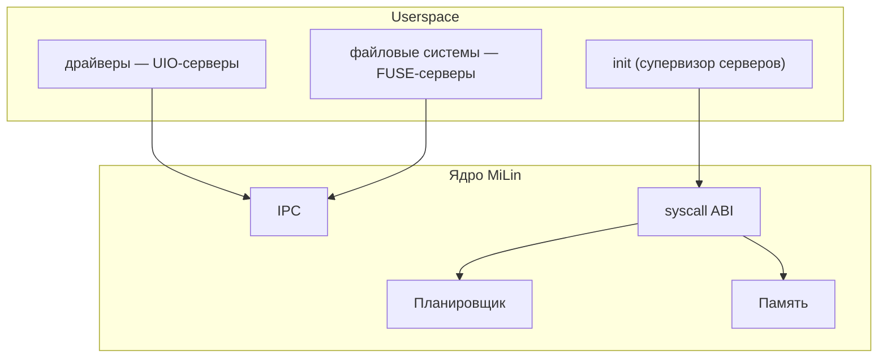

<div align="center">

# MiLin

**Вырезаем из Linux микроядро. В прямом смысле.**

[](https://github.com/mel0k1/MiLin/actions/workflows/ci.yml)
[](LICENSE)
[](https://github.com/mel0k1/linux)
[]()

MiLin — это эксперимент: мы берём настоящее ядро Linux и методично режем
его, превращая монолит в микроядро. Драйверы и файловые системы уезжают
в userspace, в ядре остаются только планировщик, память и IPC.

English version: [README_EN.md](README_EN.md)

</div>

## Зачем это

Linux — великий монолит. Вся система живёт в режиме ядра: каждый драйвер,
каждая файловая система, каждый протокол. Микроядро — противоположная идея:
в привилегированном режиме остаётся минимум, а всё остальное работает
обычными процессами в userspace.

Мы решили не спорить на форумах, а попробовать самим: что останется, если
из Linux вырезать всё, без чего ядро ещё может жить? Где проходит эта
граница? Насколько она дальше, чем принято думать?

Отличительная черта MiLin: **после каждого шага резни система продолжает
грузиться**. Мы не пишем новое ядро — мы оперируем живым.

## Целевая архитектура



## План

| Этап | Название | Суть |
|------|----------|------|
| M1 | Базовый бут | настоящее ядро + минимальный конфиг + QEMU ✅ |
| M2 | Конфиг-диета | всё лишнее выключено, bzImage −23% ✅ |
| M3 | Резня в исходниках | физическое удаление подсистем: дерево −92% ✅ |
| M4 | Userspace-изация | драйверы → UIO-серверы, ФС → FUSE-серверы |
| M5 | Микроядерный IPC | обмен сообщениями endpoint→endpoint |
| M6 | Отчёт | честные метрики «до/после» |

Подробности и критерии готовности — в [docs/roadmap.md](docs/roadmap.md).

## Прогресс похудения

| метрика | M1 | M2 | M3 | Δ M1→M3 |
|---------|----|----|----|---------|
| bzImage | 1.00 МиБ | 0.77 МиБ | 0.77 МиБ | **−22.9%** |
| текст-код ядра | 3.89 МиБ | 3.40 МиБ | ~3.4 МиБ | −12.8% |
| CONFIG =y | 529 | 460 | 460 | −13.0% |
| **дерево исходников** | 1.8G | 1.8G | **139 МиБ** | **−92%** |
| файлов в дереве | 94,856 | 94,856 | 12,212 | −87% |
| строк .c/.h | 37.2M | 37.2M | 3.5M | −91% |
| время бута в QEMU | 1.65 с | 1.16 с | 1.19 с | −28% |

В M3 режется само дерево исходников (bzImage почти не меняется — M2 уже
выключил этот код из сборки). Метрики: `docs/metrics/m3.json`.

## Где что живёт

| репозиторий | что это |
|-------------|---------|
| [mel0k1/MiLin](https://github.com/mel0k1/MiLin) | проект: инструменты, конфиг-конституция, CI, docs, скрипт резни |
| [mel0k1/linux](https://github.com/mel0k1/linux) (форк torvalds/linux) | обрезанное дерево, ветка `milin` — база v7.2 минус подсистемы |

Форк сохраняет настоящую историю Linux: любой вырезанный кусок можно
посмотреть/вернуть/сравнить с апстримом. Коммит резни за коммитом:
[`arch`](https://github.com/mel0k1/linux/commit/179c7ed22) →
[`deadtop`](https://github.com/mel0k1/linux/commit/65d2116a0) →
[`subsys`](https://github.com/mel0k1/linux/commit/80b676285) →
[`drivers`](https://github.com/mel0k1/linux/commit/2df94c852) →
[`fs/kernel/tools`](https://github.com/mel0k1/linux/commit/1800ab624).

## Быстрый старт

```bash
git clone https://github.com/mel0k1/MiLin.git && cd MiLin
git clone --depth 1 -b milin https://github.com/mel0k1/linux.git linux
TREE_DIR=$PWD/linux tools/build.sh    # собрать build/bzImage из обрезанного дерева
tools/run-qemu.sh                     # загрузиться и увидеть приветствие
```

Без клонирования дерева `tools/build.sh` соберёт baseline из tarball
kernel.org (как в M1/M2). Зависимости: `gcc make flex bison bc cpio curl
qemu-system-x86`. Ядро и все инструменты — x86_64.

## Структура репозитория

```
├── tools/            # скрипты: build, carve.sh (резня), fix-dead-refs.py,
│                     # mkinitramfs, run-qemu, size-report, tree-metrics
├── configs/          # milin.config — конституция конфигурации ядра
├── init/             # userspace /init — первый процесс MiLin
├── docs/             # дорожная карта, логи бута, метрики, будущий отчёт
└── .github/          # CI: сборка из обрезанного дерева + QEMU smoke-тест
```

## Лицензия

GPL-2.0 — как и оригинальный Linux, из которого мы всё это вырезаем.
