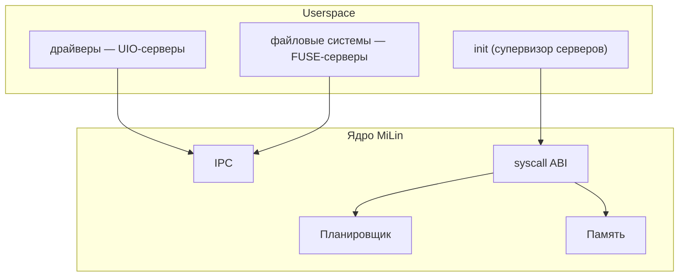

<div align="center">

# MiLin

**Вырезаем из Linux микроядро. В прямом смысле.**

[](https://github.com/mel0k1/MiLin/actions/workflows/ci.yml)
[](LICENSE)
[](https://github.com/mel0k1/linux)
[]()

MiLin — это эксперимент: мы берём настоящее ядро Linux и методично режем
его, превращая монолит в микроядро. Драйверы и файловые системы уезжают
в userspace, в ядре остаются только планировщик, память и IPC.

English version: [README_EN.md](README_EN.md)

</div>

## Зачем это

Linux — великий монолит. Вся система живёт в режиме ядра: каждый драйвер,
каждая файловая система, каждый протокол. Микроядро — противоположная идея:
в привилегированном режиме остаётся минимум, а всё остальное работает
обычными процессами в userspace.

Мы решили не спорить на форумах, а попробовать самим: что останется, если
из Linux вырезать всё, без чего ядро ещё может жить? Где проходит эта
граница? Насколько она дальше, чем принято думать?

Отличительная черта MiLin: **после каждого шага резни система продолжает
грузиться**. Мы не пишем новое ядро — мы оперируем живым.

## Целевая архитектура



## План

| Этап | Название | Суть |
|------|----------|------|
| M1 | Базовый бут | настоящее ядро + минимальный конфиг + QEMU ✅ |
| M2 | Конфиг-диета | всё лишнее выключено, bzImage −23% ✅ |
| M3 | Резня в исходниках | физическое удаление подсистем: дерево −92% ✅ |
| M4 | Userspace-изация | драйверы → UIO-серверы, ФС → FUSE-серверы ✅ |
| M5 | Микроядерный IPC | mbus-реестр + lane-хэндлы + bragi-сообщения ✅ |
| M5.1 | Асинхронные очереди | HelQueue в разделяемой памяти + futex + creds ✅ |
| M6 | Отчёт | честные метрики «до/после» |

Подробности и критерии готовности — в [docs/roadmap.md](docs/roadmap.md).

## Прогресс похудения

| метрика | M1 | M2 | M3 | M4 | M5 | M5.1 | Δ M1→M5.1 |
|---------|----|----|----|----|----|------|---------|
| bzImage | 1.00 МиБ | 0.77 МиБ | 0.77 МиБ | 0.94 МиБ | 1.33 МиБ | 1.34 МиБ | +34% |
| текст-код ядра | 3.89 МиБ | 3.40 МиБ | ~3.4 МиБ | ~3.7 МиБ | ~4.2 МиБ | ~4.2 МиБ | см. M6 |
| CONFIG =y | 529 | 460 | 460 | 448 | 472 | 476 | −10% |
| **дерево исходников** | 1.8G | 1.8G | **139 МиБ** | 154 МиБ | 164 МиБ | 164 МиБ | **−90.9%** |
| файлов в дереве | 94,856 | 94,856 | 12,212 | 13,054 | 13,475 | 13,475 | −85.8% |
| строк .c/.h | 37.2M | 37.2M | 3.5M | 4.0M | 4.3M | 4.3M | −88.4% |
| время бута в QEMU | 1.65 с | 1.16 с | 1.19 с | 1.30 с | 1.50 с | 1.50 с | −9% |

В M3 режется само дерево исходников (bzImage почти не меняется — M2 уже
выключил этот код из сборки). В M4 bzImage отрастает на +21.6% — это не
обратная дietetика, а цена контракта серверов: ядро возвращает не драйверы
и не файловые системы, а интерфейсы, через которые userspace ими управляет
(MULTIUSER, PCI-шина, UIO, FUSE, devtmpfs, sysfs). В M5 +41% — цена
транспорта IPC: AF_UNIX тянет за собой net/core, netlink, sched, loopback
и kernel/bpf (select-контракт v7.2). Протокольные семейства (inet и
прочее) остаются вырезанными — net/Kconfig у MiLin авторский, минимальный.
M5.1 добавляет только futex-контракт: +8 КБ (+0.6%). Метрики:
`docs/metrics/m4.json`, `docs/metrics/m5.json`, `docs/metrics/m51.json`.

## Где что живёт

| репозиторий | что это |
|-------------|---------|
| [mel0k1/MiLin](https://github.com/mel0k1/MiLin) | проект: инструменты, конфиг-конституция, CI, docs, скрипт резни |
| [mel0k1/linux](https://github.com/mel0k1/linux) (форк torvalds/linux) | обрезанное дерево, ветка `milin` — база v7.2 минус подсистемы |

Форк сохраняет настоящую историю Linux: любой вырезанный кусок можно
посмотреть/вернуть/сравнить с апстримом. Коммит резни за коммитом:
[`arch`](https://github.com/mel0k1/linux/commit/179c7ed22) →
[`deadtop`](https://github.com/mel0k1/linux/commit/65d2116a0) →
[`subsys`](https://github.com/mel0k1/linux/commit/80b676285) →
[`drivers`](https://github.com/mel0k1/linux/commit/2df94c852) →
[`fs/kernel/tools`](https://github.com/mel0k1/linux/commit/1800ab624).

## Быстрый старт

```bash
git clone https://github.com/mel0k1/MiLin.git && cd MiLin
git clone --depth 1 -b milin https://github.com/mel0k1/linux.git linux
TREE_DIR=$PWD/linux tools/build.sh    # собрать build/bzImage из обрезанного дерева
tools/run-qemu.sh                     # бут: супервизор поднимает серверы, demo FUSE+UIO
```

Без клонирования дерева `tools/build.sh` соберёт baseline из tarball
kernel.org (как в M1/M2). Зависимости: `gcc make flex bison bc cpio curl
qemu-system-x86`. Ядро и все инструменты — x86_64.

## Структура репозитория

```
├── tools/            # скрипты: build, carve.sh (резня), fix-dead-refs.py,
│                     # mkinitramfs, run-qemu, size-report, tree-metrics
├── configs/          # milin.config — конституция конфигурации ядра
├── userspace/        # супервизор /init и серверы: mlbus (реестр), logsrv,
│                     # fused (FUSE), uiod (UIO), ipc.h (формат сообщений)
├── docs/             # дорожная карта, логи бута, метрики, будущий отчёт
└── .github/          # CI: сборка из обрезанного дерева + QEMU smoke-тест
```

## M4 в двух словах

После загрузки ядро не знает ни файловых систем, ни драйверов «по-настоящему»:

1. супервизор `/init` монтирует devtmpfs и sysfs, привязывает PCI-устройство
   к userspace-драйверу (`/sys/.../uio_pci_generic/new_id`);
2. `uiod` — userspace-драйвер: мапит BAR0 через `/dev/uio0` и читает регистр
   железа (qemu pci-testdev);
3. `fused` — userspace-файловая система: монтирует `/mnt` через `/dev/fuse` и
   отвечает ядру FUSE_INIT/LOOKUP/GETATTR;
4. клиент, созданный с `setuid(1000)` (вернулся MULTIUSER), читает
   `/mnt/README` через FUSE-сервер — uid-изоляция и сервер работают вместе.

## M5 в двух словах

Серверы перестают быть сиротами: у них есть шина (идея mbus из Managarm,
транспорт — простой IPC на AF_UNIX SOCK_SEQPACKET):

1. `mlbus` — реестр: сервер делает `REGISTER("log")`, клиент —
   `LOOKUP("log")`; шина создаёт socketpair и раздаёт концы через
   SCM_RIGHTS — дальше общение endpoint→endpoint, шина данных не видит
   (аналог GetRemoteLane);
2. сообщения — в стиле bragi: заголовок `{proto, msg_id, err, tail_len}`
   + inline-поля + переменный tail + hooks (хэндлы); одно сообщение =
   один атомарный пакет;
3. клиент (uid 1000) получает lane, отправляет два WRITE и STATS;
   log-сервер печатает их в UART, отвечает ack и отдаёт `served=2`;
4. FUSE-регрессия M4 проходит: тот же клиент читает `/mnt/README`;
5. супервизор останавливает долгоживущие серверы SIGTERM'ом, как
   положено микроядерному менеджеру.

## M5.1 в двух словах: HelQueue

Транспорт M5 честный, но медленный (два syscall'а на сообщение, ядро
копирует данные). У Managarm очереди HelQueue живут в разделяемой памяти —
ядро в data path не участвует. Идея пересажена на user↔user:

1. пара очередей в shm-регионе (ramfs-файл → MAP_SHARED → fd по
   SCM_RIGHTS → unlink — без TMPFS и MEMFD_CREATE);
2. чанки с progress-словом и length-prefixed элементы — потребитель
   читает payload прямо из общей памяти (zero copy);
3. будильник — futex-слово с битами DATA/SUPPLY: атомарный OR/AND и
   парковка настоящим futex (аналог HelFutex);
4. flow control — возврат чанков свободным списком;
5. creds: SO_PASSCRED/SCM_CREDENTIALS — ядро прикладывает ucred к
   сообщениям, шина пересылает его серверу, лог подписывается uid=1000.

Бенчмарк в системе (QEMU TCG, rdtsc, n=256; для относительного сравнения):
RTT seqpacket 297.7K циклов → очередь+futex 181.7K (×1.64) →
поллинг+yield 161.2K (×1.85); постановка в очередь пачкой — 5.1K
циклов/сообщение (в 58 раз дешевле RTT). Цена: CONFIG_FUTEX = +8 КБ
bzImage (+0.6%). Полный разбор — `docs/metrics/m51.json`, лог бута —
`docs/boot-m51.log`.

## Лицензия

GPL-2.0 — как и оригинальный Linux, из которого мы всё это вырезаем.
