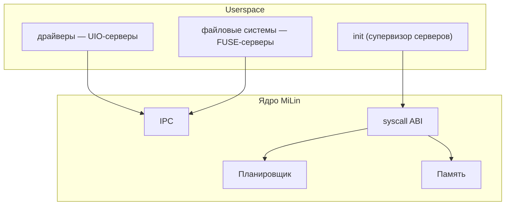

<div align="center">

# MiLin

**Вырезаем из Linux микроядро. В прямом смысле.**

[](https://github.com/mel0k1/MiLin/actions/workflows/ci.yml)
[](LICENSE)
[](https://kernel.org)
[]()

MiLin — это эксперимент: мы берём настоящее ядро Linux и методично режем
его, превращая монолит в микроядро. Драйверы и файловые системы уезжают
в userspace, в ядре остаются только планировщик, память и IPC.

English version: [README_EN.md](README_EN.md)

</div>

## Зачем это

Linux — великий монолит. Вся система живёт в режиме ядра: каждый драйвер,
каждая файловая система, каждый протокол. Микроядро — противоположная идея:
в привилегированном режиме остаётся минимум, а всё остальное работает
обычными процессами в userspace.

Мы решили не спорить на форумах, а попробовать самим: что останется, если
из Linux вырезать всё, без чего ядро ещё может жить? Где проходит эта
граница? Насколько она дальше, чем принято думать?

Отличительная черта MiLin: **после каждого шага резни система продолжает
грузиться**. Мы не пишем новое ядро — мы оперируем живым.

## Целевая архитектура



## План

| Этап | Название | Суть |
|------|----------|------|
| M1 | Базовый бут | настоящее ядро + минимальный конфиг + QEMU ✅ |
| M2 | Конфиг-диета | выключить всё, без чего ядро ещё живёт |
| M3 | Резня в исходниках | физическое удаление подсистем из дерева |
| M4 | Userspace-изация | драйверы → UIO-серверы, ФС → FUSE-серверы |
| M5 | Микроядерный IPC | обмен сообщениями endpoint→endpoint |
| M6 | Отчёт | честные метрики «до/после» |

Подробности и критерии готовности — в [docs/roadmap.md](docs/roadmap.md).

## Быстрый старт

```bash
git clone https://github.com/mel0k1/MiLin.git && cd MiLin
tools/fetch-linux.sh   # скачать исходники Linux (~180 МБ)
tools/build.sh         # собрать build/bzImage
tools/run-qemu.sh      # загрузиться в QEMU и увидеть приветствие
```

Зависимости: `gcc make flex bison bc cpio curl qemu-system-x86`.
Ядро и все инструменты — x86_64.

## Структура репозитория

```
├── tools/            # скрипты резни: fetch, build, initramfs, qemu
├── configs/          # milin_defconfig — наша конфигурация ядра
├── init/             # userspace /init — первый процесс MiLin
├── docs/             # дорожная карта, логи бута, будущий отчёт
└── .github/          # CI: сборка ядра + QEMU smoke-тест
```

## Лицензия

GPL-2.0 — как и оригинальный Linux, из которого мы всё это вырезаем.
