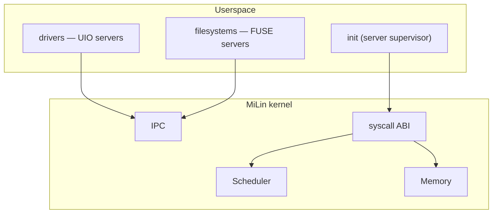

<div align="center">

# MiLin

**Carving a microkernel out of Linux. Literally.**

[](https://github.com/mel0k1/MiLin/actions/workflows/ci.yml)
[](LICENSE)
[](https://github.com/mel0k1/linux)
[]()

MiLin is an experiment: we take the real Linux kernel and methodically cut
it down, turning the monolith into a microkernel. Drivers and filesystems
move to userspace; only the scheduler, memory management and IPC stay
inside the kernel.

Русская версия: [README.md](README.md)

</div>

## Why

Linux is a great monolith. Everything lives in kernel mode: every driver,
every filesystem, every protocol. A microkernel is the opposite idea: the
privileged mode keeps a bare minimum, while the rest runs as ordinary
userspace processes.

We decided not to argue on forums but to try it ourselves: what remains if
you cut out of Linux everything the kernel can survive without? Where does
that boundary lie? How much further is it than commonly assumed?

The defining trait of MiLin: **after every cutting step the system still
boots**. We are not writing a new kernel — we are operating on a living one.

## Target architecture



## Roadmap

| Stage | Name | Essence |
|-------|------|---------|
| M1 | Baseline boot | real kernel + minimal config + QEMU ✅ |
| M2 | Config diet | everything optional disabled, bzImage −23% ✅ |
| M3 | Source carving | physically delete subsystems: tree −92% ✅ |
| M4 | Userspace-ization | drivers → UIO servers, filesystems → FUSE servers ✅ |
| M5 | Microkernel IPC | mbus registry + lane handles + bragi messages ✅ |
| M5.1 | Async queues | HelQueue in shared memory + futex + creds ✅ |
| M6 | Report | honest before/after metrics |

Details and acceptance criteria — in [docs/roadmap.md](docs/roadmap.md)
(in Russian, auto-translation works fine).

## Weight-loss progress

| metric | M1 | M2 | M3 | M4 | M5 | M5.1 | Δ M1→M5.1 |
|--------|----|----|----|----|----|------|---------|
| bzImage | 1.00 MiB | 0.77 MiB | 0.77 MiB | 0.94 MiB | 1.33 MiB | 1.34 MiB | +34% |
| kernel text | 3.89 MiB | 3.40 MiB | ~3.4 MiB | ~3.7 MiB | ~4.2 MiB | ~4.2 MiB | see M6 |
| CONFIG =y | 529 | 460 | 460 | 448 | 472 | 476 | −10% |
| **source tree** | 1.8G | 1.8G | **139 MiB** | 154 MiB | 164 MiB | 164 MiB | **−90.9%** |
| files in tree | 94,856 | 94,856 | 12,212 | 13,054 | 13,475 | 13,475 | −85.8% |
| .c/.h lines | 37.2M | 37.2M | 3.5M | 4.0M | 4.3M | 4.3M | −88.4% |
| QEMU boot time | 1.65 s | 1.16 s | 1.19 s | 1.30 s | 1.50 s | 1.50 s | −9% |

M3 carves the source tree itself (bzImage barely changes — M2 already
excluded that code from the build). In M4 bzImage grows by +21.6% — this is
not a diet reversal, it's the price of the server contract: the kernel
returns not drivers and not filesystems, but the interfaces through which
userspace controls them (MULTIUSER, the PCI bus, UIO, FUSE, devtmpfs,
sysfs). In M5 it grows +41% — the price of the IPC transport: AF_UNIX pulls
in net/core, netlink, sched, loopback and kernel/bpf (the v7.2 select
contract). Protocol families (inet and friends) stay carved out — MiLin's
net/Kconfig is hand-written and minimal. M5.1 adds only the futex
contract: +8 KB (+0.6%). Metrics: `docs/metrics/m4.json`,
`docs/metrics/m5.json`, `docs/metrics/m51.json`.

## What lives where

| repository | what it is |
|-------------|---------|
| [mel0k1/MiLin](https://github.com/mel0k1/MiLin) | the project: tools, config constitution, CI, docs, carve script |
| [mel0k1/linux](https://github.com/mel0k1/linux) (fork of torvalds/linux) | the carved tree, branch `milin` — v7.2 baseline minus subsystems |

The fork keeps the real Linux history: every carved-out piece can be
inspected, restored or diffed against upstream. The carve, commit by commit:
[`arch`](https://github.com/mel0k1/linux/commit/179c7ed22) →
[`deadtop`](https://github.com/mel0k1/linux/commit/65d2116a0) →
[`subsys`](https://github.com/mel0k1/linux/commit/80b676285) →
[`drivers`](https://github.com/mel0k1/linux/commit/2df94c852) →
[`fs/kernel/tools`](https://github.com/mel0k1/linux/commit/1800ab624).

## Quick start

```bash
git clone https://github.com/mel0k1/MiLin.git && cd MiLin
git clone --depth 1 -b milin https://github.com/mel0k1/linux.git linux
TREE_DIR=$PWD/linux tools/build.sh    # build build/bzImage from the carved tree
tools/run-qemu.sh                     # boot: the supervisor raises servers, FUSE+UIO demo
```

Without cloning the tree, `tools/build.sh` builds the baseline from the
kernel.org tarball (the M1/M2 way). Dependencies: `gcc make flex bison bc
cpio curl qemu-system-x86`. The kernel and all tooling are x86_64.

## Repository layout

```
├── tools/            # scripts: build, carve.sh (the knife), fix-dead-refs.py,
│                     # mkinitramfs, run-qemu, size-report, tree-metrics
├── configs/          # milin.config — the kernel config constitution
├── userspace/        # the /init supervisor and servers: fused (FUSE), uiod (UIO)
├── docs/             # roadmap, boot logs, metrics, future report
└── .github/          # CI: build from the carved tree + QEMU smoke test
```

## M4 in a nutshell

After boot the kernel no longer "really" knows filesystems or drivers:

1. the `/init` supervisor mounts devtmpfs and sysfs, binds a PCI device to
   its userspace driver (`/sys/.../uio_pci_generic/new_id`);
2. `uiod` — a userspace driver: mmaps BAR0 via `/dev/uio0` and reads a
   hardware register (qemu pci-testdev);
3. `fused` — a userspace filesystem: mounts `/mnt` via `/dev/fuse` and
   answers the kernel's FUSE_INIT/LOOKUP/GETATTR;
4. a client created with `setuid(1000)` (MULTIUSER is back) reads
   `/mnt/README` through the FUSE server — uid isolation and the server
   working together.

## M5 in a nutshell

Servers are no longer orphans: they have a bus (the mbus idea from
Managarm, transport is plain IPC over AF_UNIX SOCK_SEQPACKET):

1. `mlbus` — the registry: a server does `REGISTER("log")`, a client does
   `LOOKUP("log")`; the bus creates a socketpair and hands out both ends
   via SCM_RIGHTS — communication then goes endpoint→endpoint, the bus
   never sees the data (GetRemoteLane analog);
2. messages follow the bragi style: header `{proto, msg_id, err,
   tail_len}` + inline fields + variable tail + hooks (handles); one
   message = one atomic packet;
3. the client (uid 1000) gets a lane, sends two WRITEs and STATS; the log
   server prints them to the UART, answers with acks and reports `served=2`;
4. the M4 FUSE regression passes: the same client reads `/mnt/README`;
5. the supervisor stops long-running servers with SIGTERM, like a proper
   microkernel manager.

## M5.1 in a nutshell: HelQueue

The M5 transport is honest but slow (two syscalls per message, the kernel
copies the data). In Managarm, HelQueue queues live in shared memory — the
kernel never touches the data path. The idea has been transplanted to
user↔user and mixed with plain IPC:

1. a pair of queues in a shm region (ramfs file → MAP_SHARED → fd via
   SCM_RIGHTS → unlink — no TMPFS, no MEMFD_CREATE);
2. chunks with a progress word and length-prefixed elements — the consumer
   reads the payload straight from shared memory (zero copy);
3. the wakeup is a futex word with DATA/SUPPLY bits: atomic OR/AND and
   real futex parking (the HelFutex analog);
4. flow control — consumed chunks go back to a free list;
5. creds: SO_PASSCRED/SCM_CREDENTIALS — the kernel attaches a ucred to
   every lane message, the bus forwards it to the server, log records are
   signed with uid=1000.

In-system benchmark (QEMU TCG, rdtsc, n=256; for relative comparison):
seqpacket RTT 297.7K cycles → queue+futex 181.7K (×1.64) → poll+yield
161.2K (×1.85); batched enqueue costs 5.1K cycles/message (58× cheaper
than an seqpacket RTT). Price: CONFIG_FUTEX = +8 KB of bzImage (+0.6%).
Full analysis in `docs/metrics/m51.json`, boot log in
`docs/boot-m51.log`.

## License

GPL-2.0 — same as the original Linux we carve all of this from.
