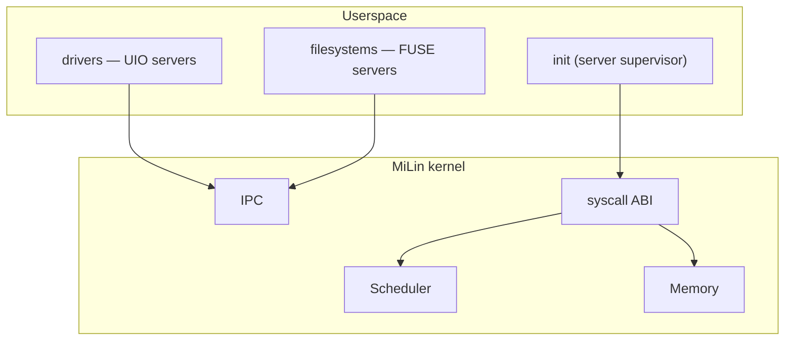

<div align="center">

# MiLin

**Carving a microkernel out of Linux. Literally.**

[](https://github.com/mel0k1/MiLin/actions/workflows/ci.yml)
[](LICENSE)
[](https://kernel.org)
[]()

MiLin is an experiment: we take the real Linux kernel and methodically cut
it down, turning the monolith into a microkernel. Drivers and filesystems
move to userspace; only the scheduler, memory management and IPC stay
inside the kernel.

Русская версия: [README.md](README.md)

</div>

## Why

Linux is a great monolith. Everything lives in kernel mode: every driver,
every filesystem, every protocol. A microkernel is the opposite idea: the
privileged mode keeps a bare minimum, while the rest runs as ordinary
userspace processes.

We decided not to argue on forums but to try it ourselves: what remains if
you cut out of Linux everything the kernel can survive without? Where does
that boundary lie? How much further is it than commonly assumed?

The defining trait of MiLin: **after every cutting step the system still
boots**. We are not writing a new kernel — we are operating on a living one.

## Target architecture



## Roadmap

| Stage | Name | Essence |
|-------|------|---------|
| M1 | Baseline boot | real kernel + minimal config + QEMU ✅ |
| M2 | Config diet | everything optional disabled, bzImage −23% ✅ |
| M3 | Source carving | physically delete subsystems from the tree |
| M4 | Userspace-ization | drivers → UIO servers, filesystems → FUSE servers |
| M5 | Microkernel IPC | endpoint→endpoint message passing |
| M6 | Report | honest before/after metrics |

Details and acceptance criteria — in [docs/roadmap.md](docs/roadmap.md)
(in Russian, auto-translation works fine).

## Weight-loss progress

| metric | M1 | M2 | Δ |
|--------|----|----|---|
| bzImage | 1.00 MiB | 0.77 MiB | **−22.9%** |
| text code | 3.89 MiB | 3.40 MiB | −12.8% |
| CONFIG =y | 529 | 460 | −13.0% |
| QEMU boot time | 1.65 s | 1.16 s | −30% |

CI computes the metrics for every commit (`tools/size-report.sh`) —
check the job summary in Actions.

## Quick start

```bash
git clone https://github.com/mel0k1/MiLin.git && cd MiLin
tools/fetch-linux.sh   # download Linux sources (~180 MB)
tools/build.sh         # build build/bzImage
tools/run-qemu.sh      # boot in QEMU and see the greeting
```

Dependencies: `gcc make flex bison bc cpio curl qemu-system-x86`.
The kernel and all tooling are x86_64.

## Repository layout

```
├── tools/            # carving scripts: fetch, build, initramfs, qemu
├── configs/          # milin_defconfig — our kernel configuration
├── init/             # userspace /init — the first MiLin process
├── docs/             # roadmap, boot logs, future report
└── .github/          # CI: kernel build + QEMU smoke test
```

## License

GPL-2.0 — same as the original Linux we carve all of this from.
