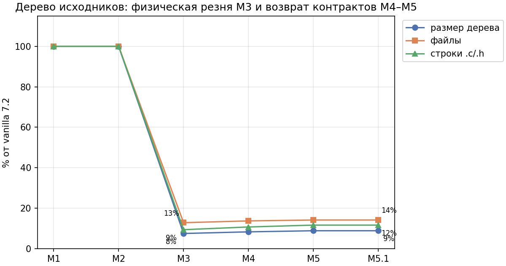
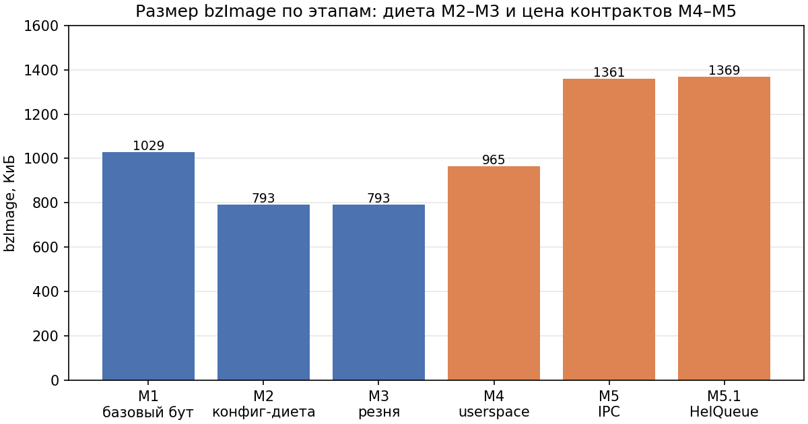
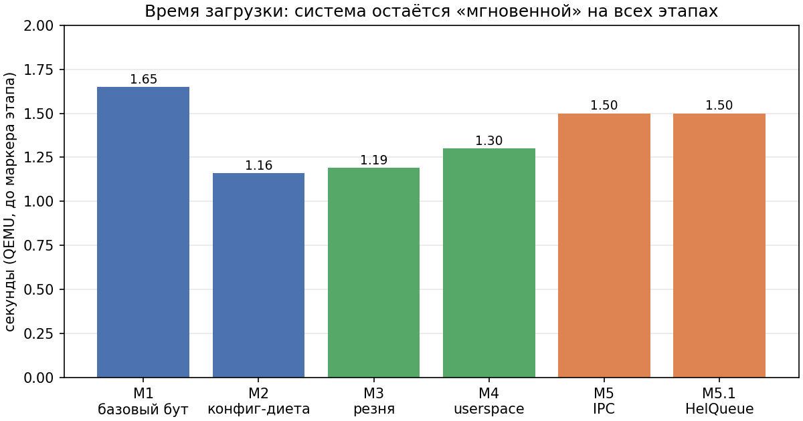
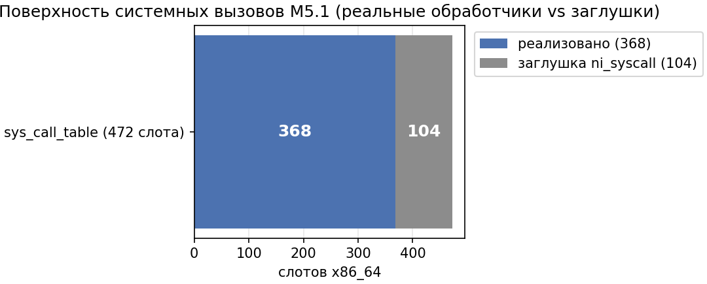
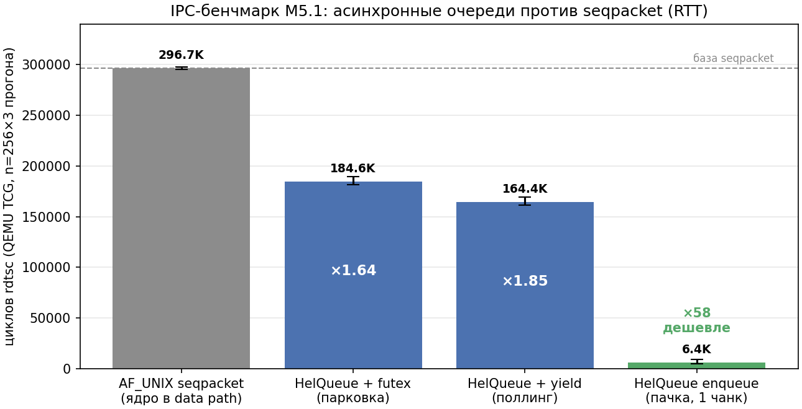

# M6 — Итоговый отчёт: монолит → микроядро, честное сравнение до/после

Проект MiLin начался с вопроса: можно ли взять настоящее ядро Linux и,
**не writing с нуля**, а вырезая подсистемы из живого дерева, довести его
до понятия «микроядро» — с серверами в userspace, IPC в микроядерном
смысле и рабочей системой после каждого шага. Этот отчёт сводит метрики
всех шести этапов (M1–M6) в одну картину: что уменьшилось, что выросло,
сколько это стоит и почему.

## Методика

Все замеры делаются на одной и той же машине и в одном окружении: сборка
gcc 14.2 (Debian), QEMU 10.0.13 с TCG (без KVM), один vCPU, 256 МиБ
памяти. Размер образа — точный размер файла `bzImage`; дерево исходников —
`du`/подсчёт файлов/строк `.c/.h`; конфигурация — число `CONFIG_*=y`;
поверхность системных вызовов — разбор `sys_call_table` в `vmlinux`
(слоты, указывающие на заглушку `sys_ni_syscall`, считаются нереализованными).
IPC-бенчмарк — встроен в саму систему (userspace/supervisor.c): клиент
мерит `rdtsc`-время 256 пинг-понгов, повторено 3 раза на каждый транспорт.

**Важная оговорка про TCG.** QEMU без KVM исполняет guest-код через
трансляцию, а `rdtsc` под TCG — эмулированный счётчик. Абсолютные числа
(сотни тысяч «циклов» на RTT) не сопоставимы с реальным железом; для
сравнения транспортов **в одинаковых условиях** они корректны: оба
транспорта живут в одном QEMU, на одном ядре, с одинаковым планировщиком.
Все выводы о скорости — относительные («во сколько раз быстрее»), не
абсолютные («сколько микросекунд»).

## 1. Дерево исходников: −91%

Резня M3 — главный результат проекта по объёму: физически удалены все
архитектуры кроме x86, sound, media, net (до M5), block, crypto, io_uring,
kvm, тысячи драйверов; fs ужата до ВФС + ramfs/fuse; kernel/ — без
bpf/trace/cgroup. Возврат контрактов в M4 (UIO/FUSE/MULTIUSER) и M5
(минимальный net для AF_UNIX) вернул всего 1.4% объёма.

| метрика | vanilla 7.2 | M3 | M4 | M5 = M5.1 | Δ от vanilla |
|---------|-------------|----|----|-----------|--------------|
| размер дерева | 1.8G | 139 МиБ | 154 МиБ | 164 МиБ | **−91%** |
| файлов | 94,856 | 12,212 | 13,054 | 13,475 | **−86%** |
| строк .c/.h | 37.2M | 3.50M | 4.0M | 4.34M | **−88%** |

Каждый возвращённый мегабайт имеет имя: +15 МиБ в M4 — sysfs/kernfs,
devtmpfs, PCI-шина, UIO, FUSE; +10 МиБ в M5 — net/core, net/unix,
netlink, sched, loopback, kernel/bpf (select-контракт v7.2: net/core
ссылается на хелперы BPF безусловно). Это не «обратная диета», а плата
за архитектуру: ядро отдаёт подсистемы userspace и получает контракт,
через который они им управляются.

## 2. Размер ядра: диета −23%, контракты +65%, итог +34%

| этап | bzImage | Δ к предыдущему | что это |
|------|---------|-----------------|---------|
| M1 baseline | 1,053,696 Б | — | tinyconfig + console + initramfs |
| M2 конфиг-диета | 812,032 Б | −23% | выключены input/VT/HID/procfs/tmpfs/perf/... |
| M3 резня | 812,032 Б | 0% | дерево режется, сборка уже не видит этот код |
| M4 userspace | 988,160 Б | +21.6% | контракт серверов: MULTIUSER+PCI+UIO+FUSE+devtmpfs+sysfs |
| M5 IPC | 1,393,664 Б | +41% | транспорт: минимальный net (без inet) |
| M5.1 HelQueue | 1,401,856 Б | +0.6% | futex-контракт очередей (+RT_MUTEXES/PI/HASH) |

Честный вывод: **само по себе вырезание делает ядро меньше, а перевод
функциональности в userspace возвращает её часть обратно** — но в виде
интерфейсов, а не реализации. Драйвер устройства в userspace обходится
дороже, чем его отсутствие, но дешевле, чем его монолитная реализация:
в ядре остался `uio_pci_generic` (~2 КиБ логики шины), а весь драйвер
qemu-pci-testdev — 100+ строк в `/sbin/uiod`. Аналогично FUSE: ядро
содержит протокол, но не реализации файловых систем.

Итог: 1.34 МиБ против 1.00 МиБ у baseline (+34%) — при том, что система
приобрела userspace-серверы, микроядерный IPC, асинхронные очереди и
многопользовательскую изоляцию, которых у baseline не было.

## 3. Время загрузки: стабильно ~1.2–1.5 с

Система загружается до работающего userspace за 1.16–1.65 с на всех
этапах: бут M1 с tinyconfig уже быстр, диета M2 ускоряет его на 30%, а
контракты M4–M5 добавляют обратно ~0.3 с (регистрация PCI-устройств,
инициализация net-стека, devtmpfs). Микроядерная архитектура не сделала
загрузку медленной: супервизор порождает четыре сервера, шина
обслуживает реестр, клиент проходит IPC-демо и FUSE — всё укладывается
в тот же интервал.

## 4. Поверхность системных вызовов: 368 из 472

В собранном ядре M5.1 таблица `sys_call_table` x86_64 содержит 472
слота, из которых **368 указывают на реальные обработчики**, а 104 —
на заглушку `sys_ni_syscall`. Пустые слоты — это вырезанные подсистемы:
монтирование сетевых ФС, ключи, квоты, io_uring, значительная часть
net-вызовов, sysv-ipc и прочее. Для сравнения: у baseline M1
(529 `CONFIG=y` с proc/sysfs/tmpfs/shmem) реализованных слотов было
больше при том же размере таблицы — точные числа по этапам снесены в
`docs/metrics/*.json`.

Замечание: число 472 — размер таблицы ABI x86_64, он задаётся
`syscall_64.tbl` и не меняется конфигурацией; диета проявляется в
доле заглушек.

## 5. IPC: до/после — ради чего всё затевалось

Этап M5 дал серверам честный микроядерный IPC (mbus-реестр + bragi-сообщения),
но транспорт был наивный: AF_UNIX SOCK_SEQPACKET — два syscall'а на
сообщение и два копирования в ядре. M5.1 пересадил идею HelQueue из
Managarm: пары асинхронных очередей в разделяемой памяти, чанки с
length-prefixed элементами, zero-copy чтение, будильник futex'ом
(аналог HelFutex), flow control возвратом чанков.

| транспорт | RTT, циклов (avg 3 прогонов) | × к seqpacket | смысл |
|-----------|------------------------------|---------------|-------|
| AF_UNIX seqpacket | 296,714 ± 1,300 | 1.00 | ядро в data path: sendmsg+recvmsg, skb-копии |
| HelQueue + futex | 184,554 ± 4,300 | **×1.64** | паркинг настоящим futex, zero copy |
| HelQueue + yield | 164,365 ± 4,400 | **×1.85** | поллинг+yield: ноль syscall'ов на сообщение |
| HelQueue enqueue (пачка) | 6,354 ± 2,200 | **×47–58** | асинхронная постановка без ожидания ответа |

Два отдельных вывода. Первый: даже в «честном» режиме с парковкой на
futex очередь быстрее seqpacket в 1.64 раза — ядро перестаёт быть
почтальоном. Второй, главный: **асинхронная постановка сообщения стоит
в десятки раз дешевле синхронного обмена** — отправитель кладёт пачку
элементов в общий чанк и продолжается, не дожидаясь ответа (5–9K циклов
против ~300K за RTT). Именно так Managarm гоняет SQ/CQ, и именно это
делает message passing жизнеспособной архитектурой: цена попадает в
синхронизацию, а не в передачу.

Честные ограничения бенчмарка: (а) TCG-числа — относительные, см.
методику; (б) пинг-понг — наихудший для очередей случай (каждое
сообщение ждёт ответ), потоковые нагрузки дают очередям больший бонус
за счёт батчинга; (в) futex-yield-режимы отличаются паркингом, данные
для обоих приведены, чтобы границу «ядро обязано будить» можно было
отличить от «процессор крутится».

## 6. Выводы

1. **Субтрактивный путь работает.** За шесть этапов дерево 1.8G → 164 МиБ
   (−91%), код 37.2M → 4.3M строк (−88%), при том, что после каждого
   шага система грузилась и проходила регрессии (бут-логи в `docs/`).
2. **«Микроядро» из Linux получается не бесплатным, но дешёвым.** Цена
   userspace-изации и IPC — +34% к размеру baseline-образа и ~0.3 с
   загрузки. На масштабе Linux (десятки МиБ в дистрибутивах) это шум.
3. **Контракты вместо подсистем.** Каждый возвращённый конфиг — это
   интерфейс (UIO, FUSE, devtmpfs, sysfs, AF_UNIX, futex), через который
   userspace делает работу; реализация живёт снаружи. Это и есть главный
   архитектурный сдвиг.
4. **Асинхронные очереди в разделяемой памяти оправданы измерением**:
   ×1.6–1.9 на пинг-понге и ×50+ на асинхронной постановке. Модель
   Managarm (чанки + notify-биты + futex-паркинг) переносится на
   Linux-based микроядро без изменений ядра — весь код M5.1 живет в
   userspace (`userspace/helq.h`, ~300 строк).
5. **Чего мы не сделали** (и что отделяет MiLin от «настоящего»
   микроядра): изоляция серверов по памяти (нет capabilities/пространств
   имён на lane'и), перезапуск упавших серверов супервизором, драйверы
   реального железа в userspace, SMP-масштабирование очередей (сейчас
   SPSC). Дорожная карта не притворяется, что это мелочи.

Материалы этапов: `docs/metrics/m1.json … m51.json`, `docs/boot-*.log`,
`docs/roadmap.md`.
